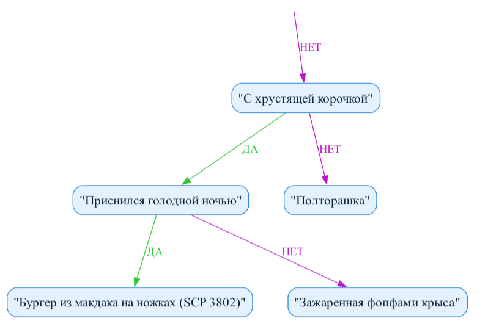
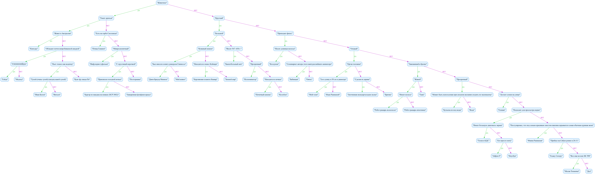

# Акинатор на бинарном дереве

> Реализация одной из популярнейшей нелинейных структур данных - дерева (бинарного дерева), а с его помощью - игру "Акинатор" с несколько расширенным относительно классического функционалом и графическим дампом (все по базе короче)


<p align="center">
  <br>
  <em>Картинка пары веточек для привлечения внимания</em>
</p>

## О проекте
В рамках задачи реализована структура данных бинарного дерева в классической реализации (через динамическое выделение памяти для каждого узла отдельно, в отличие от реализации в [связном списке](https://github.com/mathusha2023/linked_list)). Кроме того, созданы функции для записи содержимого дерева в файл (в форматах PREORDER, INORDER и POSTORDER), а также получения дерева из файла в PREORDER формате (подробнее в [формат файла данных](#формат-хранения-данных-акинатора-и-читалки)). На основе этого реализована игра [Акинатор](#акинатор), базу для которой пользователь создает сам. 


---


## Акинатор
Пользователю на выбор предоставляются 4 варианта: 
- угадать обьект и, если загаданного еще не существует, добавить его
- посмореть дерево всех ответов Акинатора
- возможность посмотреть описание обьекта из его дерева
- возможность сравнить описания двух обьектов


---


## Формат хранения данных Акинатора и читалки
Формат префиксный, вот как он выглядит: 
```
("Животное" ("Полторашка" nil nil) ("А когда выпьет" ("Виталя" nil nil) ("Леха" nil nil)))
```


## Красивые картиночки
<p align="center">
  <br>
  <em>Изображение полного дерева акинатора, присутствующего на данный момент</em>
</p>


---


## Связь со мной
Я всегда рад отзывам, предложениям, общению и денюжке. Свяжитесь со мной, если хотите предложить мне один из этих пунктов: [му](https://t.me/mathusha2023)
